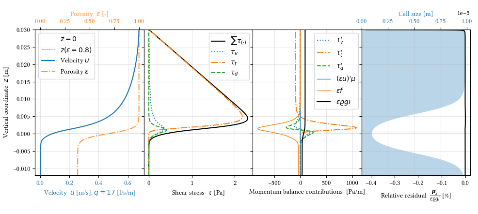

# A Finite Element resolution of the vertical velocity profile of turbulent flows over steep rough porous beds

## Governing equation

See [(Rousseau, 2019)](https://www.cambridge.org/core/journals/journal-of-fluid-mechanics/article/an-experimental-investigation-of-turbulent-freesurface-flows-over-a-steep-permeable-bed/E7D19E212687A82479AABD0852FE3DC5) for the theoretical development and the experimental evidence for the dispersive stress.

$$0 = \epsilon\varrho g i + \epsilon\bar f + \left(\tau_v + \tau_t + \tau_d\right)' - \mu\epsilon'u',$$
$$\tau = \tau_v + \tau_t + \tau_d, \quad z=z_\text{surface}$$
$$u = u_\text{bulk}, \quad z\rightarrow -\infty$$

- $\epsilon$ : porosity
- $\varrho$ : fluid's unit mass
- $g$ : gravitational acceleration
- $i$ : slope
- $f$ : drag force density
- $\tau_v$ : viscous stress
- $\tau_t$ : Reynolds stress
- $\tau_d$ : dispersive stress
- $\mu$ : dynamic viscosity
- $u$ : flow speed
- $(\cdot)'$ : derivative along vertical coordinate

## Closures

- The viscous stress
$$\tau_v = \mu\left(\epsilon u\right)'$$

- The Reynolds stress [(Li & Sawamoto 1995)](https://www.tandfonline.com/doi/abs/10.1080/05785634.1995.11952813)
$$\tau_t = -\varrho\epsilon\kappa^2 Z_{LS}^2 \left(1-e^{-\sqrt{\frac{Z_{LS}u}{\nu A_\ast^2}}}\right)^2 u'^2$$

- The dispersive stress [(Rousseau, 2019)](https://www.cambridge.org/core/journals/journal-of-fluid-mechanics/article/an-experimental-investigation-of-turbulent-freesurface-flows-over-a-steep-permeable-bed/E7D19E212687A82479AABD0852FE3DC5)
$$\tau_d = - \frac{1-\epsilon}{1-\epsilon_b}\varrho\lambda d_p\epsilon uu'$$

- The drag force density (Kozeny-Carman)
$$\epsilon\bar{f} = - \frac{A_E(1-\epsilon)^2}{\epsilon d_p^2}\mu u - \frac{B_E(1-\epsilon)\epsilon}{d_p}\varrho u^2$$

## Typical result

